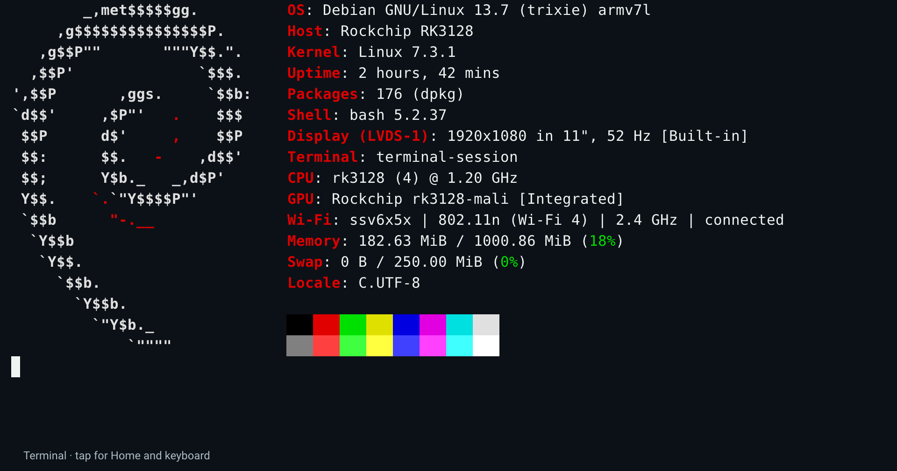

# Rockchip RK3128 / RK31xx Linux Hardware Reference

Reference for Rockchip Linux kernel drivers and modern Debian: native RK3128 support on **Linux 7.3.1 / Debian 13 armhf**, tested on an **RK3128 reference board with 1 GiB RAM and a 1920×1080 LVDS display**. Source, patches, configuration, examples and checks are included; applications and a complete bootable system are outside this collection. [Versions and patch order](docs/KERNEL.md) · [Source pins](docs/PROVENANCE.md) · [Validation](docs/VALIDATION.md).

Tested on **RK3128**. Shared Rockchip IP drivers and techniques may help other **RK31xx** ports; register maps, clocks, resets, power domains and board device trees require chip-specific checks.

## Measured improvements

- **Lima/Mali-400 graphics:** captured demo fragment shaders compile to **42 instructions instead of 76 with upstream Lima (~45% fewer)**. The full optimized graphics stack doubled bottlenecked demo scenes from **~25.5 to 51 FPS** at unchanged clocks, including presentation-pacing changes outside this collection. [Measurements and scope](docs/GPU.md#measured-graphics-improvements).
- **Hardware video:** RK3128 HEVC enablement, shared Hantro/HEVC bus arbitration and H.264 fixes, validated with reference-frame comparisons and zero-drop 1080p playback tests. [Media](docs/MEDIA.md).
- **Stable scanout:** initializing the LCDC NoC priority eliminated measured FIFO underflows in matched workloads, where decoder drop counters alone had missed the problem. [Display evidence](docs/DISPLAY.md#finite-evidence-and-limits).
- **Audio CPU cost:** patched ALSA reduced one-core CPU use from **2.18% to 0.82% (~62% less)** versus Debian libasound in the same 44.1 kHz stereo playback test, with zero underruns. [Measurement](docs/PERIPHERALS.md#measured-audio-cpu-cost).
- **Hardware JPEG:** a tested 12 MP baseline JPEG decoded and converted to RGB in **386 ms versus 1.70 s with stb_image software decoding (~4.4× faster)**. [Measurement and limits](docs/MEDIA.md#jpeg-decode-and-encoder-baseline).

## Hardware reference

| Component | Native driver capability and limits | Details |
| --- | --- | --- |
| Cortex-A7 CPU | Four cores, NEON/VFPv4, 216–1008 MHz DVFS; optional busy-core policy for the reference board allows 1200 MHz for one busy core with validated voltage/caps | [CPU/memory](docs/CPU-MEMORY.md) |
| DDR3 / memory controller | Board-specific SRAM transition 300→396 MHz at logic 1.25 V; CMA and DMA cache-coherency fixes | [CPU/memory](docs/CPU-MEMORY.md) |
| VOP / LCDC | Atomic DRM scanout, video colour encoding/range, FIFO/bus counters; **LCDC NoC priority 3/3 fixes measured scanout underruns** | [Display](docs/DISPLAY.md) |
| LVDS / display PHY | Native LVDS; reference board panel power/handoff and measured 1920×1080 at ≈51 Hz | [Display](docs/DISPLAY.md) |
| Mali-400 MP2 | Lima GLES 2.0, Mesa compiler/buffer optimizations, GP/PP counters and memory accounting; no Vulkan | [GPU](docs/GPU.md) |
| Hantro G1 / VPU1 decode | H.264 and baseline JPEG 4:2:0/4:2:2; JPEG 48–8176 pixels per axis; progressive/grayscale/4:4:4 need another decoder | [Media](docs/MEDIA.md) |
| HEVC decoder | Native rkvdec HEVC with shared Hantro-bus arbitration and contiguous scanout buffers | [Media](docs/MEDIA.md) |
| Hantro H1 / VEPU1 encode | JPEG; H.264 constrained-baseline IDR and VP8 profile 0 keyframes up to 1920×1080 visible; constant QP, no inter-frame/rate control/MVC claim | [Media](docs/MEDIA.md) |
| RGA1-plus | V4L2 copy/scale/transform, fill/gradient/palette, alpha/ROP and planar prescale subsets; format/control restrictions and no RGB→709 output | [Media](docs/MEDIA.md) |
| IEP v1 | 14 RGB/YUV layouts, deinterlacing, colour/BCSH and selected 3×3/5×5 enhancement; scaling/larger radii/unsafe combinations refused | [Media](docs/MEDIA.md) |
| Internal audio codec / I2S | Native ALSA playback, 44.1 kHz shared mix, NEON softvol/dmix optimizations; fitted board has one mono speaker | [Peripherals](docs/PERIPHERALS.md) |
| Crypto v1 | Guarded MD5/SHA1/SHA256 DMA and low-priority AES/DES/EDE PIO wrappers; native cipher DMA/runtime power-down remain experimental | [Crypto](docs/CRYPTO.md) |
| Oscillator RNG | Health-tested hwrng with conservative credit and failure latch; finite estimates, no certification claim | [Crypto](docs/CRYPTO.md) |
| eMMC / SDIO / DMA | 8-bit eMMC DDR52 at 50 MHz, PL330 DMA; Wi-Fi SDIO DMA at 37.5 MHz on the tested board | [Peripherals](docs/PERIPHERALS.md) |
| USB OTG / PHY | dwc2 peripheral mode and standalone CDC-NCM configfs example | [Peripherals](docs/PERIPHERALS.md) |
| PWM / GPIO / clocks / power | Reference board voltage/backlight/panel wiring, reset/watchdog/ramoops and halt/power-key support; settings are board-specific | [Kernel](docs/KERNEL.md), [CPU/memory](docs/CPU-MEMORY.md) |
| Silead touch (board peripheral) | Calibration, contact tracking/prediction/filtering and finite corpus checks; firmware supplied separately | [Touch](docs/TOUCH.md) |
| SSV6006C Wi-Fi (board peripheral) | SDIO station-mode source, scanning/reconnect/2.4 GHz preference; separate firmware required; GPLv3 portions have a kernel-license compatibility boundary | [Peripherals](docs/PERIPHERALS.md), [licenses](NOTICE.md) |
| RTC / keys / sensors (board peripherals) | HYM8563 RTC and reference board input/sensor DT references; optional ADC/IR disabled in the selected profile | [Peripherals](docs/PERIPHERALS.md) |
| HDMI / CVBS / camera / Ethernet | Not wired or not validated on this board; this collection makes no working-support claim | [Board limits](docs/PERIPHERALS.md) |

[Hardware tools and examples](docs/TOOLS.md) · [Numerical proofs and historical experiments](research-tools/README.md). Firmware binaries are not included. Original kernel contributions are **GPL-2.0-only**; existing upstream and component licenses remain in force: [LICENSE](LICENSE), [NOTICE.md](NOTICE.md).
